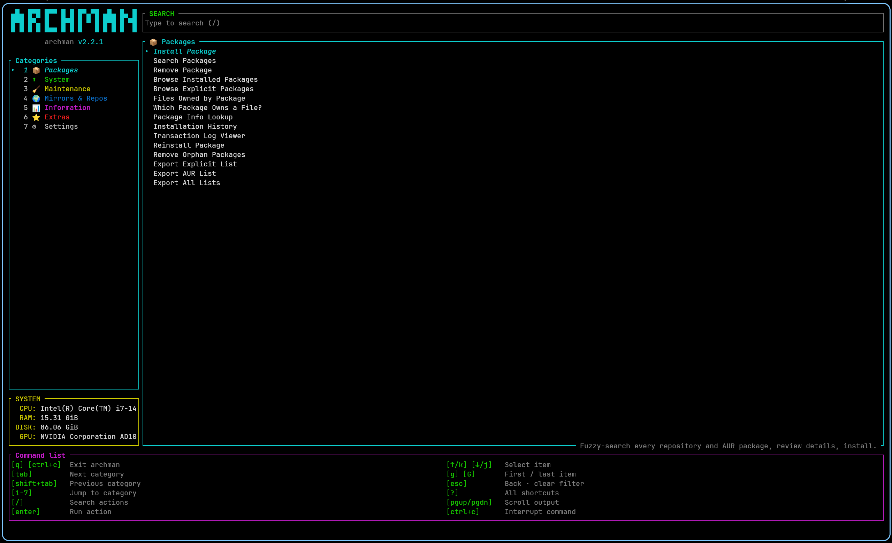

<div align="center">

  

  # archman

  **Interactive Arch Linux System Manager & TUI Dashboard**

  *A fast, keyboard-driven terminal dashboard engineered in native Rust for seamless package management, mirror ranking, and system maintenance.*

  <br />

  <a href="https://www.archlinux.org/"></a>
  <a href="https://www.rust-lang.org/"></a>
  <a href="https://github.com/ratatui/ratatui"></a>
  <a href="https://github.com/ankur3-101106/pacman-utils/releases"></a>
  <a href="LICENSE"></a>

  <br />

  [**Overview**](#-overview) •
  [**Features**](#-features) •
  [**Preflight & Preview**](#-preflight-checks--transaction-preview) •
  [**Keybindings**](#-keyboard-shortcuts) •
  [**Embedded Runner**](#-embedded-command-runner) •
  [**Installation**](#-installation) •
  [**Configuration**](#-configuration)

</div>

---

## 🚀 Overview

**archman** is a native **Rust** TUI (built on [ratatui](https://github.com/ratatui/ratatui) + [crossterm](https://github.com/crossterm-rs/crossterm)) inspired by [LinUtil](https://github.com/ChrisTitusTech/linutil). Everything lives in one cohesive dashboard:

- 🗂️ **Category Sidebar:** Instant switching with live system telemetry (kernel, uptime, CPU, RAM, updates)
- 📋 **Flat Action List:** Curated maintenance and package operations with real-time descriptions
- 🔍 **Global Fuzzy Search:** Filter and launch any action across categories in milliseconds
- 💻 **Embedded Command Runner:** Pacman, AUR helpers (`yay`/`paru`), and `reflector` execute directly inside the pane, forwarding keystrokes (`sudo` passwords, `[Y/n]` prompts) in real-time

<details>
<summary><b>View Retro ASCII Banner</b></summary>

```text
 █████╗ ██████╗  ██████╗██╗  ██╗███╗   ███╗ █████╗ ███╗   ██╗
██╔══██╗██╔══██╗██╔════╝██║  ██║████╗ ████║██╔══██║████╗  ██║
███████║██████╔╝██║     ███████║██╔████╔██║███████║██╔██╗ ██║
██╔══██║██╔══██╗██║     ██╔══██║██║╚██╔╝██║██╔══██║██║╚██╗██║
██║  ██║██║  ██║╚██████╗██║  ██║██║ ╚═╝ ██║██║  ██║██║ ╚████║
╚═╝  ╚═╝╚═╝  ╚═╝ ╚═════╝╚═╝  ╚═╝╚═╝     ╚═╝╚═╝  ╚═╝╚═╝  ╚═══╝
```

</details>

<br />

<p align="center">
  
</p>

---

## ✨ Features

| | Feature | Description |
|---|---|---|
| 📦 | **Packages** | Install (official + AUR, dry-run mode), search, remove (3 strategies), browse, file ownership, package info, history, transaction log, reinstall, orphans, export/import lists |
| 🛡 | **Preflight & Preview** | Preflight safety checks (database lock, active PIDs, disk space, privileges, network) and non-destructive transaction previews before execution |
| ⬆ | **System** | Update check (`checkupdates`), database refresh, full upgrades via pacman or your AUR helper |
| 🧹 | **Maintenance** | Cache cleaning (`paccache -rkN`, `-Sc`, `-Scc`), safe `db.lck` removal |
| 🌍 | **Mirrors & Repos** | `reflector` auto-update & ranking, mirrorlist backup/restore, add & remove third-party repositories (Chaotic-AUR, CachyOS, BlackArch) |
| 📊 | **Information** | System dashboard, dependency check with one-key installs |
| ⭐ | **Extras** | Favorite packages, 13 curated package groups (incl. BlackArch pentesting tools), list import, Homebrew (`brew`) installer & uninstaller |
| ⚙ | **Settings** | AUR helper (`yay`/`paru`), dry-run mode, independent confirmation controls, logging, cache retention |

---

## 🛡 Preflight Checks & Transaction Preview

Before performing state-altering package actions, `archman` executes preflight validation and displays an interactive **Transaction Preview**:

- **Preflight Checks:**
  - **Database Lock:** Verifies `/var/lib/pacman/db.lck` is not present, inspecting `/proc` for active pacman processes. Blocks if locked.
  - **Executables:** Confirms required binaries (`pacman`, `sudo`, `yay`, `paru`) exist in `PATH`. Blocks if missing.
  - **Root / Sudo:** Checks for root privileges or cached `sudo` credentials. Warns if password prompt will be required.
  - **Network:** Detects network interface state for operations requiring remote mirrors.
  - **Disk Space:** Evaluates root partition free space (blocks if < 100 MB, warns if < 1 GB).
  - **Target Safety:** Rejects invalid shell characters or empty target specifications.
- **Transaction Preview:** Runs non-destructive `pacman --print` to inspect resolved targets and download URLs. Honest preview limitations are noted when using AUR helpers or operations where non-destructive simulation is unsupported.

---

## ⚙ Confirmation Architecture

Confirmation controls are strictly separated for safety and flexibility:

| Setting | Purpose | Default |
|---|---|---|
| `CONFIRM_ACTIONS` | Controls whether **archman's TUI** prompts for confirmation before launching operations | `true` |
| `NATIVE_CONFIRM` | Controls whether the **underlying package manager** (`pacman`/`yay`/`paru`) prompts natively (when `false`, appends `--noconfirm` to supported transactions) | `true` |
| `DRY_RUN` | Simulates execution without modifying packages or system state | `false` |

---

## ⌨ Keyboard Shortcuts

| Key | Action |
|:---|:---|
| <kbd>↑</kbd> / <kbd>↓</kbd> (<kbd>k</kbd> / <kbd>j</kbd>) | Move selection |
| <kbd>/</kbd> | Search all actions |
| <kbd>Tab</kbd> / <kbd>Shift</kbd>+<kbd>Tab</kbd> | Next / previous category |
| <kbd>1</kbd> … <kbd>7</kbd> | Jump straight to category number |
| <kbd>g</kbd> / <kbd>G</kbd> | First / last action |
| <kbd>Enter</kbd> | Run or open the selected action |
| <kbd>Esc</kbd> | Go back · clear search filter |
| <kbd>q</kbd> | Quit application |
| <kbd>?</kbd> | Shortcut cheatsheet overlay |
| <kbd>Ctrl</kbd>+<kbd>c</kbd> | Quit / interrupt running command |

> [!NOTE]
> **Accessibility First**
> Every category pairs a color with a number; selection uses a cursor glyph plus bold-italic text (never color alone); statuses pair icons (`✔ ⚠ ✘`) with color; secondary text uses high-contrast grays; and `NO_COLOR` strips all styling while maintaining complete legibility.

---

## 🖥 Embedded Command Runner

Commands never take over or corrupt your terminal. They run on a dedicated pseudo-terminal (PTY) **inside the action pane**:

- **Live Output Streaming:** Progress bars, downloads, and package builds render cleanly in real time
- **Interactive Forwarding:** `sudo` password prompts and pacman `[Y/n]` confirmations work directly in-pane
- **Color-Coded Status Borders:** Border highlights in **cyan** while running, **green** on success, and **red** on failure
- **Clean Signal Handling:** <kbd>Ctrl</kbd>+<kbd>c</kbd> sends terminal interrupt; forced cancellation reaps child processes without PID recycling risks
- **Scrollback History:** Navigate output logs smoothly with <kbd>PgUp</kbd> and <kbd>PgDn</kbd>
- **Background Execution:** Launching commands from sub-screens returns you to the dashboard while jobs finish

> [!IMPORTANT]
> **Note on Interactive Cancellation**
> While package operations and AUR helpers respond immediately to `<kbd>Ctrl</kbd>+<kbd>c</kbd>`, `reflector` currently does not cleanly exit on terminal interrupt within the embedded runner and should be allowed to finish or terminated externally.

---

## 📦 Installation

### 1. Direct Binary Install via `curl` *(Recommended)*

```bash
sudo curl -fsSL https://github.com/ankur3-101106/pacman-utils/releases/latest/download/archman -o /usr/local/bin/archman && sudo chmod +x /usr/local/bin/archman
```

Or download into the current directory and move:

```bash
curl -fsSL https://github.com/ankur3-101106/pacman-utils/releases/latest/download/archman -o archman
chmod +x archman
sudo mv archman /usr/local/bin/
```

### 2. Via GitHub Releases

Download the latest pre-compiled `archman` binary directly from the [Releases](https://github.com/ankur3-101106/pacman-utils/releases) page.

### 3. Build from Source

```bash
git clone https://github.com/ankur3-101106/pacman-utils.git
cd pacman-utils
./install.sh          # builds release with cargo, then optionally installs to /usr/local/bin
```

---

## 🔧 Dependencies

| Dependency | Status | Purpose |
|:---|:---:|:---|
| `pacman` | **Required** | Core Arch Linux package manager |
| Rust Toolchain | **Build Only** | [rustup](https://rustup.rs) or `sudo pacman -S rust` |
| `yay` / `paru` | *Optional* | AUR helper integration |
| `brew` | *Optional* | Homebrew package manager support |
| `reflector` | *Optional* | Mirrorlist ranking & auto-update |
| `pacman-contrib` | *Optional* | Cache cleaning (`paccache`) & update checks (`checkupdates`) |

---

## ⚙ Configuration

Configuration files are stored in `~/.config/archman/` (auto-generated on first launch):

| File | Purpose |
|:---|:---|
| `settings.conf` | AUR helper, dry-run mode, confirmation toggles, logging, cache retention |
| `favorites.txt` | Your starred / favorite packages list |
| `archman.log` | Historical activity and execution log |

---

## 📖 Usage

```bash
# Launch the interactive dashboard
archman

# Check current version
archman --version

# Display CLI help and options
archman --help
```

---

## 🏗 Project Structure

```
pacman-utils/
├── Cargo.toml            # package manifest — archman v2.2.1
├── Cargo.lock            # locked dependency versions
├── install.sh            # builds (release), then asks to install to /usr/local/bin
├── img/
│   ├── archman-logo.svg  # official logo
│   └── snapshot.png      # dashboard screenshot
├── LICENSE               # GPL-2.0
├── .github/
│   └── workflows/
│       └── ci.yml        # CI workflow (formatting, linting, tests, release build)
└── src/
    ├── main.rs           # entry point: CLI flags, terminal lifecycle, panic hook
    ├── app.rs            # App core: screen stack, modals, toasts, event loop, command queue
    ├── cmd.rs            # centralized command engine (CommandSpec, CommandEngine, execution modes)
    ├── tx.rs             # transaction layer: specifications, preflight checks, preview generation
    ├── pty.rs            # hardened pseudo-terminal execution for embedded commands
    ├── widgets.rs        # logo, menus, fuzzy lists, text viewers, theme helpers, cheatsheet
    ├── settings.rs       # ~/.config/archman — settings, favorites, activity log
    ├── sys.rs            # pacman / AUR / reflector wrappers, capability detection, background jobs
    ├── fuzzy.rs          # subsequence fuzzy matcher
    └── screens/
        ├── mod.rs           # module registry + shared helpers
        ├── registry.rs      # declarative category → action table (the whole UI surface)
        ├── home.rs          # two-pane dashboard (sidebar + action pane)
        ├── runpane.rs       # embedded command runner pane
        ├── preview.rs       # transaction preflight & preview modal screen
        ├── install.rs       # install packages — fuzzy search, details, review, install
        ├── search.rs        # search official repos + AUR
        ├── remove.rs        # remove packages (-R / -Rs / -Rns)
        ├── packages.rs      # browse, files, owner query, info, history, txn log, reinstall, orphans
        ├── update.rs        # update check, database refresh, full upgrades
        ├── lockfile.rs      # inspect / safely remove pacman's db.lck
        ├── mirrors.rs       # reflector mirror ranking, backup / restore
        ├── info.rs          # system dashboard
        ├── settingsscr.rs   # settings editor + dependency check
        ├── favorites.rs     # favorite packages
        ├── groups.rs        # curated package groups
        ├── exportimport.rs  # import package lists
        └── viewer.rs        # generic scrollable text viewer
```

---

## 🤝 Contributing

Contributions are welcome! To contribute:

1. Fork the repository
2. Create your feature branch (`git checkout -b feature/amazing-feature`)
3. Commit your changes (`git commit -m 'feat: add amazing feature'`)
4. Push to the branch (`git push origin feature/amazing-feature`)
5. Open a Pull Request

Run `cargo test` before submitting — the test suite validates settings, fuzzy matching, preflight validation, transactions, the PTY layer, and the runner pane. Full guidelines and conventions are in [CONTRIBUTING.md](CONTRIBUTING.md).

---

## 🛡 Security

`archman` executes system-level operations — please report security vulnerabilities privately according to [SECURITY.md](SECURITY.md) instead of creating public issues.

---

## 📜 Code of Conduct

This project adheres to the [Contributor Covenant](CODE_OF_CONDUCT.md). By participating, you are expected to honor this code.

---

## 📄 License

Distributed under the **GNU General Public License v2.0**. See [LICENSE](LICENSE) for details.

